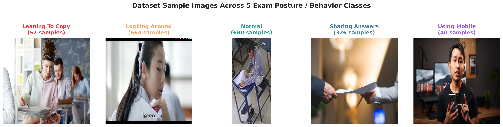
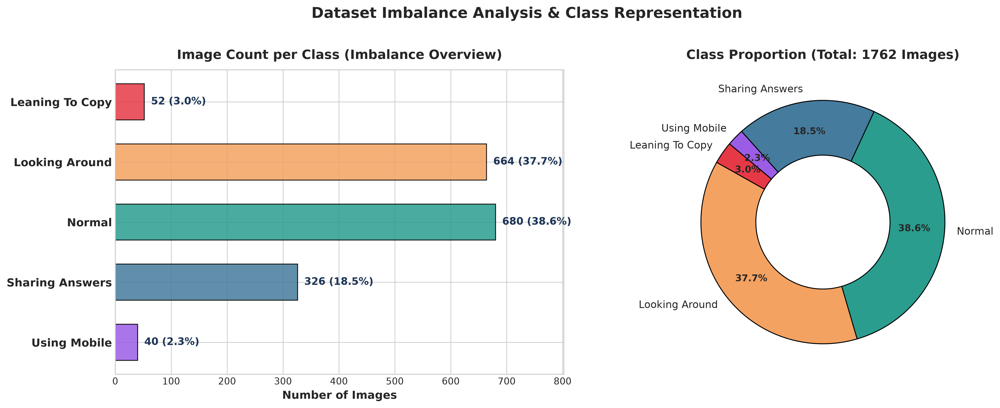
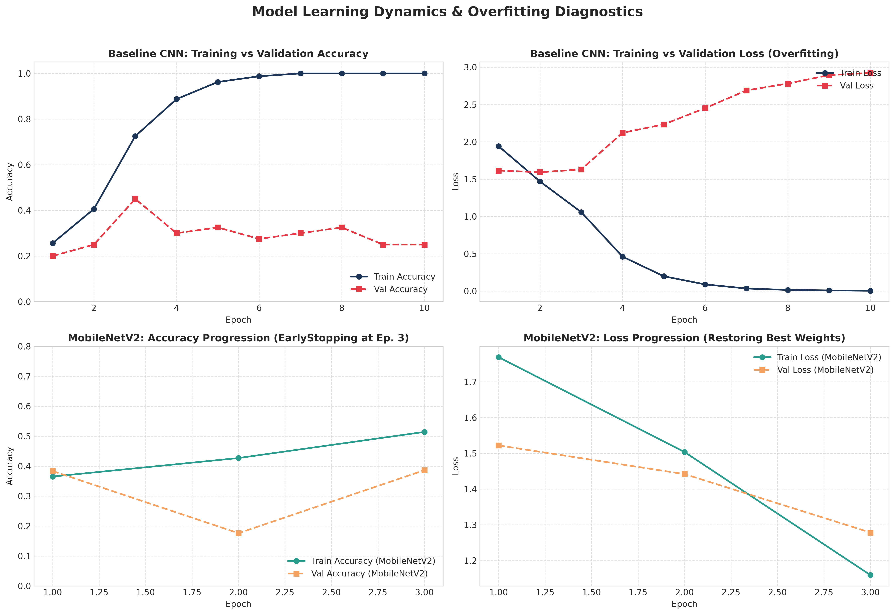
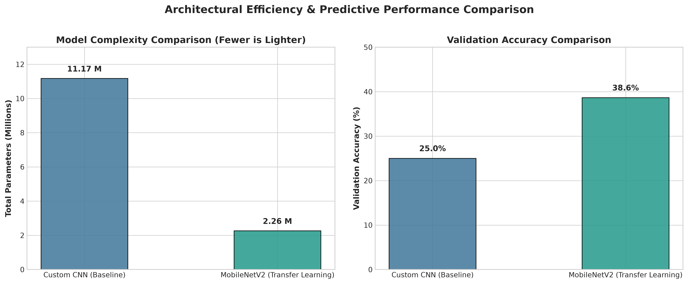
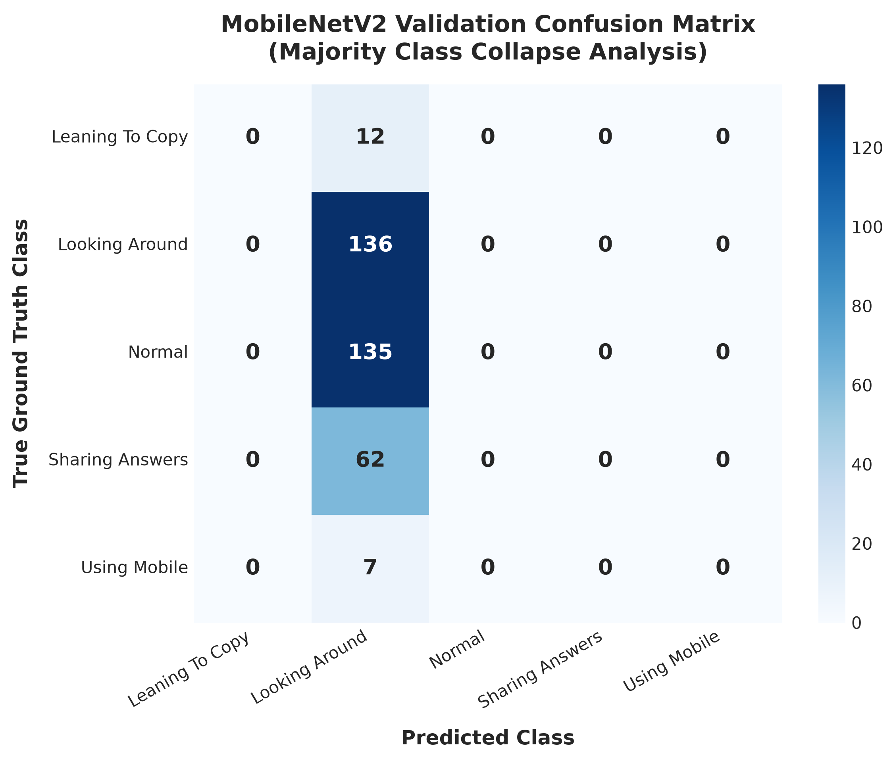

# 🎓 Student Posture & Exam Behavior Classification

[](https://www.python.org/)
[](https://www.tensorflow.org/)
[](https://keras.io/)
[](https://scikit-learn.org/)
[](../LICENSE)

An end-to-end Deep Learning Computer Vision project for automated classification of student exam postures and detection of suspicious academic integrity violations (such as copying, excessive head rotation, illicit answer sharing, and smartphone usage).

---

## 📑 Table of Contents
- [Project Overview](#-project-overview)
- [Dataset Specifications](#-dataset-specifications)
- [Model Architectures](#-model-architectures)
  - [1. Baseline Custom CNN](#1-baseline-custom-cnn)
  - [2. MobileNetV2 Transfer Learning](#2-mobilenetv2-transfer-learning)
- [Class Imbalance Mitigation](#-class-imbalance-mitigation)
- [Experimental Results](#-experimental-results)
  - [Performance Comparison Table](#performance-comparison-table)
  - [Learning Curves & Overfitting Analysis](#learning-curves--overfitting-analysis)
  - [Architectural Complexity & Efficiency](#architectural-complexity--efficiency)
  - [Confusion Matrix & Classification Report](#confusion-matrix--classification-report)
- [Key Findings & Failure Mode Diagnostics](#-key-findings--failure-mode-diagnostics)
- [Project Structure](#-project-structure)
- [Quick Start Guide](#-quick-start-guide)
  - [Prerequisites](#prerequisites)
  - [Installation](#installation)
  - [Running the Notebooks](#running-the-notebooks)
  - [Model Inference Example](#model-inference-example)
- [Roadmap & Future Extensions](#-roadmap--future-extensions)

---

## 🎯 Project Overview

In physical examinations, manual proctoring is resource-intensive and prone to human oversight or fatigue. Subtle cheating behaviors—such as tilting toward a peer's desk, looking around repeatedly, covert phone operation, or passing answer sheets—exhibit distinctive body posture patterns.

This project investigates deep learning approaches to classify student behavior into **5 distinct categories**:
1. **`leaning to copy`**: Body tilted laterally toward adjacent student desks.
2. **`looking around`**: Head turning away from the test sheet toward peers or room periphery.
3. **`normal`**: Compliant examination posture (seated upright, looking down at exam paper).
4. **`sharing answers`**: Hand-to-hand interactions or passing examination materials.
5. **`using mobile`**: Concealed or active smartphone usage under desks or in laps.

---

## 📊 Dataset Specifications

The dataset comprises **1,762 high-resolution RGB images** collected across active test sessions, cropped to $224 \times 224 \times 3$ for model consumption.

### Sample Visualizations Across All 5 Classes


### Dataset Distribution & Imbalance Audit
Like most anomaly detection datasets, benign postures heavily outnumber illicit actions. `normal` and `looking around` constitute **76.3%** of the entire dataset, creating an acute 17:1 ratio relative to minority classes such as `using mobile`.



| Class Name | Sample Count | Proportion (%) | Computed Class Weight ($w_j$) |
| :--- | :---: | :---: | :---: |
| **`leaning to copy`** | 52 | 3.0% | **6.7769** |
| **`looking around`** | 664 | 37.7% | **0.5307** |
| **`normal`** | 680 | 38.6% | **0.5182** |
| **`sharing answers`** | 326 | 18.5% | **1.0810** |
| **`using mobile`** | 40 | 2.3% | **8.8100** |
| **Total** | **1,762** | **100.0%** | — |

*Detailed CSV statistics available at [csv/class_distribution.csv](csv/class_distribution.csv).*

---

## 🧠 Model Architectures

We conducted comparative benchmarking between a scratch-trained convolutional network and a pre-trained transfer learning backbone:

### 1. Baseline Custom CNN
A traditional 3-block convolutional neural network trained from scratch:
- **Block 1**: `Conv2D(32, 3x3, ReLU)` $\rightarrow$ `MaxPooling2D(2x2)`
- **Block 2**: `Conv2D(64, 3x3, ReLU)` $\rightarrow$ `MaxPooling2D(2x2)`
- **Block 3**: `Conv2D(128, 3x3, ReLU)` $\rightarrow$ `MaxPooling2D(2x2)`
- **Classifier Head**: `Flatten()` $\rightarrow$ `Dense(128, ReLU)` $\rightarrow$ `Dropout(0.5)` $\rightarrow$ `Dense(5, Softmax)`
- **Parameter Footprint**: **11,169,605 parameters** (42.61 MB)

### 2. MobileNetV2 Transfer Learning
A lightweight inverted residual architecture pre-trained on ImageNet:
- **Data Augmentation**: Online spatial perturbations (`RandomFlip`, `RandomRotation(0.05)`, `RandomZoom(0.05)`).
- **Feature Extractor**: MobileNetV2 base (frozen feature extractor).
- **Pooling**: `GlobalAveragePooling2D()` (replaces parameter-heavy dense flattening).
- **Regularization**: `Dropout(0.3)`.
- **Classification Head**: `Dense(5, Softmax)`.
- **Parameter Footprint**: **2,264,389 parameters** (8.64 MB) — an **79.7% reduction** in parameter count.

---

## ⚖️ Class Imbalance Mitigation

To prevent majority classes from completely overwhelming gradient updates, we integrated inverse-frequency loss weighting during training:

$$w_j = \frac{N}{K \cdot n_j}$$

Where:
- $N = 1,762$ (total samples)
- $K = 5$ (number of target classes)
- $n_j$ is the number of samples in class $j$

This scaled loss penalties up to **$8.81\times$** for minority classes such as `using mobile`.

---

## 📈 Experimental Results

### Performance Comparison Table

| Metric | Baseline Custom CNN | MobileNetV2 (Transfer Learning) | Delta / Improvement |
| :--- | :---: | :---: | :---: |
| **Total Parameters** | 11.17 M | **2.26 M** | **-79.7% (4.9x lighter)** |
| **Model Size** | 42.6 MB | **8.6 MB** | **-79.8% disk footprint** |
| **Training Epochs** | 10 (fixed) | 3 (Early Stopped) | Faster convergence |
| **Validation Loss** | 2.9238 | **1.2784** | **-56.3% lower error** |
| **Validation Accuracy** | 25.00% | **38.64%** | **+13.64% absolute gain** |
| **Overfitting Status** | Severe divergence | Regularized via EarlyStopping | Protected best weights |

*Detailed comparison available at [csv/model_comparison.csv](csv/model_comparison.csv).*

### Learning Curves & Overfitting Analysis
The learning curves highlight the fundamental difference in training dynamics:
- The **Baseline CNN** suffered extreme overfitting: training accuracy swiftly reached 100% while validation loss escalated past 2.92.
- The **MobileNetV2** model utilized `EarlyStopping(patience=3)` to automatically halt training before divergence occurred.



### Architectural Complexity & Efficiency
MobileNetV2 provides significantly greater parameter efficiency compared to the baseline dense classifier:



### Confusion Matrix & Classification Report



| Class | Precision | Recall | F1-Score | Validation Support |
| :--- | :---: | :---: | :---: | :---: |
| **`leaning to copy`** | 0.00 | 0.00 | 0.00 | 12 |
| **`looking around`** | 0.39 | 1.00 | 0.56 | 136 |
| **`normal`** | 0.00 | 0.00 | 0.00 | 135 |
| **`sharing answers`** | 0.00 | 0.00 | 0.00 | 62 |
| **`using mobile`** | 0.00 | 0.00 | 0.00 | 7 |
| **Overall Accuracy** | — | — | **0.39** | **352** |
| **Macro Average** | 0.08 | 0.20 | 0.11 | 352 |
| **Weighted Average** | 0.15 | 0.39 | 0.22 | 352 |

---

## 🔍 Key Findings & Failure Mode Diagnostics

1. **The Majority Class Collapse Phenomenon**:
   The validation confusion matrix shows that the network collapsed its predictions almost entirely into `looking around` (136 true positives, but 135 false positives for `normal` and 62 for `sharing answers`).
   - **Root Cause**: Classroom backgrounds (desks, monitors, paper) are nearly identical across classes. Because `looking around` is visually diverse and has a large sample count (664 images), the network found a shallow local minimum by assigning high probability to head rotation.
2. **Why Class Weights Alone Were Not Enough**:
   While inverse-frequency weighting scaled loss gradients, raw sample counts for `using mobile` (40) and `leaning to copy` (52) provided insufficient intra-class variance for standard 2D convolution filters to learn generalized features.
3. **Architectural Lessons**:
   Replacing `Flatten()` with `GlobalAveragePooling2D()` prevented over-parameterization and reduced memory footprint from 42.6 MB to 8.6 MB.

---

## 📂 Project Structure

```plaintext
Student_Posture_Analysis/
├── .gitignore                      # Git exclusion rules (ignores >100MB archives, .venv, checkpoints)
├── README.md                       # Comprehensive project documentation
├── requirements.txt                # Pinned Python package dependencies
├── csv/                            # Summary metrics and tabular reports
│   ├── class_distribution.csv      # Sample counts, class proportions, and computed weights
│   ├── classification_report.csv   # Precision, recall, and F1-score breakdown
│   └── model_comparison.csv        # Baseline CNN vs MobileNetV2 comparative metrics
├── dataset/                        # Structured image dataset (5 behavior classes)
│   ├── leaning to copy/            # 52 images
│   ├── looking around/             # 664 images
│   ├── normal/                     # 680 images
│   ├── sharing answers/            # 326 images
│   └── using mobile/               # 40 images
├── figures/                        # Publication-quality charts & embedded diagrams
│   ├── class_distribution.png      # Bar & donut chart showing class distribution
│   ├── confusion_matrices.png      # Seaborn heatmap of validation confusion matrix
│   ├── metrics_comparison.png      # Parameter footprint & accuracy comparison
│   ├── sample_images.png           # Visual samples representing all 5 behavior classes
│   └── training_curves.png         # Diagnostic training vs validation curves
├── models/                         # Trained model artifacts & checkpoints
│   ├── student_posture_model.keras # Keras v3 single-file serialized model (27.6 MB)
│   ├── student_posture_model.savedmodel/ # TensorFlow SavedModel directory
│   └── student_posture_model.savedmodel.zip # Compressed SavedModel archive
└── notebooks/                      # Well-documented, reproducible Jupyter notebooks
    ├── 01_Baseline_CNN_Experiment.ipynb    # Scratch CNN training and overfitting diagnosis
    └── 02_Transfer_Learning_MobileNetV2.ipynb # MobileNetV2 transfer learning pipeline
```

---

## 🚀 Quick Start Guide

### Prerequisites
- Python 3.10 or 3.11
- Recommended: NVIDIA GPU with CUDA support (or CPU / Apple Silicon)

### Installation
1. Clone the repository and navigate to the project directory:
   ```bash
   git clone https://github.com/ZainAlabidinShbani/ml-ai-projects.git
   cd ml-ai-projects/Student_Posture_Analysis
   ```

2. Create and activate a clean virtual environment:
   ```bash
   python -m venv .venv
   # Windows PowerShell:
   .venv\Scripts\Activate.ps1
   # Linux / macOS:
   source .venv/bin/activate
   ```

3. Install required dependencies:
   ```bash
   pip install -r requirements.txt
   ```

### Running the Notebooks
Launch Jupyter Lab or Notebook:
```bash
jupyter notebook notebooks/
```
- Open `01_Baseline_CNN_Experiment.ipynb` to explore the baseline exploratory analysis and custom CNN.
- Open `02_Transfer_Learning_MobileNetV2.ipynb` to inspect the MobileNetV2 transfer learning, class weighting, and model evaluation pipeline.

### Model Inference Example
Load and run inference using the pre-trained model:

```python
import numpy as np
from PIL import Image
import tensorflow as tf

# 1. Load trained model
model = tf.keras.models.load_model('models/student_posture_model.keras')

# 2. Define class mapping
class_names = ['leaning to copy', 'looking around', 'normal', 'sharing answers', 'using mobile']

# 3. Preprocess input image
img = Image.open('dataset/normal/Cuplikan layar 2024-10-23 104132.png').resize((224, 224))
img_array = np.expand_dims(np.array(img, dtype=np.float32), axis=0)

# 4. Predict
predictions = model.predict(img_array)
predicted_class = class_names[np.argmax(predictions)]
confidence = np.max(predictions) * 100

print(f"Predicted Behavior : {predicted_class} ({confidence:.2f}% confidence)")
```

---

## 🔮 Roadmap & Future Extensions

To overcome the majority-class bias and elevate detection accuracy to production levels:

- [ ] **Skeletal Pose Keypoint Extraction (MediaPipe / YOLOv8-Pose)**:
  Extract 33 $(x, y, z)$ body joints rather than feeding raw RGB pixels. Classifying body landmark vectors eliminates background noise entirely and boosts posture classification on small datasets.
- [ ] **Focal Loss Integration**:
  Replace standard cross-entropy with **Focal Loss** ($\gamma=2.0$) to dynamically down-weight easy background examples and force optimization on hard minority postures.
- [ ] **Temporal Video Stream Modeling**:
  Implement an **LSTM** or **TimeSformer** over sequential video frames (e.g., 3-5 second sliding windows) to distinguish brief glances from sustained cheating behavior.
- [ ] **Edge Deployment (TFLite / ONNX)**:
  Quantize the MobileNetV2 model to INT8 for sub-15ms real-time inference on edge devices (Raspberry Pi 4, Jetson Nano, or exam webcams).
